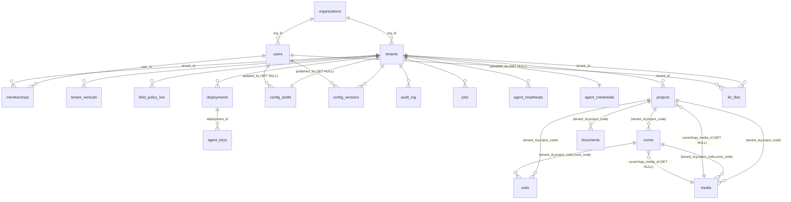

# SPEC — Lược đồ DB hiện tại (Odyssey Portal)

> Nguồn sự thật: `odyssey-portal-backend/migrations/versions/*.py` (Alembic, PostgreSQL).
> Trạng thái tại revision head **`0900_enrollment`**.
> Tài liệu này mô tả **trạng thái CUỐI sau khi chạy hết migration**, không phải từng bước.

---

## 1. Chuỗi migration

Thứ tự thực thi (linear, không branch):

```
0001_schemas → 0002_control_core → 0003_role_isolation → 0004_tenant_data
→ 0005_agent_api → 0006_jobs → 0007_heartbeats → 0100_users → 0101_memberships
→ 0200_config_store → 0201_audit_log → 0300_kb_files → 0400_bds_full
→ 0401_agent_api_bds → 0102_organizations → 0402_an_sentinel → 0900_enrollment  (HEAD)
```

Lưu ý về lịch sử: `0004_tenant_data` tạo bản **lõi** của `tenant_data.projects` và
`tenant_data.units` (chỉ đủ cột để chứng minh cách ly). `0400_bds_full` **DROP rồi tạo lại**
cả hai bảng này theo lược đồ bất động sản đầy đủ, đồng thời DROP các bảng cũ đã bỏ:
`tenant_data.import_jobs`, `project_documents`, `project_progress`, `project_highlights`.
Các bảng đó **không còn tồn tại** ở head.

---

## 2. Schema và vai trò (role)

| Schema | Nội dung | Ai đọc/ghi |
|---|---|---|
| `control` | Bảng điều khiển toàn hệ (tenant, user, config, job, key) | `portal_api` (full), `agent_all` (chỉ `agent_heartbeats`) |
| `portal` | **Chỉ chứa hàm**, không có bảng | helper dùng chung |
| `tenant_data` | Dữ liệu nghiệp vụ theo tenant, **mọi bảng bật RLS FORCE** | `portal_api` |
| `agent_api` | **Chỉ chứa view** — lớp đọc duy nhất của agent | `agent_all` (SELECT) |

Roles:

- `portal_api` — LOGIN, role runtime của backend. Có full DML trên `control`, `tenant_data`.
  **Không** có `CREATEROLE` (cố ý).
- `agent_all` — NOLOGIN, role **nhóm**. Chỉ `SELECT` trên `agent_api.*`, và
  `SELECT/INSERT/UPDATE` trên `control.agent_heartbeats`.
- `agent_<tenant_id>` — LOGIN, một role cho mỗi tenant, tạo qua
  `control.create_agent_role(tenant, password)`, tự động `GRANT agent_all`.

### Cơ chế cách ly tenant (4 điều kiện)

1. `portal.current_tenant()` → `text`, STABLE. Suy tenant theo thứ tự:
   `substring(session_user from '^agent_(.+)$')` → nếu NULL thì
   `nullif(current_setting('app.tenant_id', true), '')`.
   Nghĩa là: role `agent_xyz` tự động bị ghim vào tenant `xyz`; `portal_api` phải
   `SET LOCAL app.tenant_id` (làm ở tầng Python: `portal.core.db.session.tenant_conn()`).
2. `control.enforce_tenant_isolation('tenant_data.<table>')` — hàm bắt buộc gọi cho **mọi**
   bảng `tenant_data`. Hàm chặn nếu bảng không thuộc schema `tenant_data` hoặc thiếu cột
   `tenant_id`. Nó thực hiện: `ENABLE ROW LEVEL SECURITY` + `FORCE ROW LEVEL SECURITY`
   + `CREATE POLICY tenant_isolation USING (tenant_id = portal.current_tenant())
   WITH CHECK (cùng biểu thức)` + `GRANT SELECT,INSERT,UPDATE,DELETE ... TO portal_api`.
3. `FORCE` là bắt buộc: Postgres miễn RLS cho **chủ bảng**, thiếu dòng này thì script
   backfill / phiên debug chạy bằng owner sẽ đi xuyên cách ly.
4. Gate cột cho agent: `portal.pol(entity, field)` và `portal.gated_extras(entity, extras)`
   (đều `SECURITY DEFINER`, đọc `control.field_policy_live`).

---

## 3. Schema `control`

### 3.1 `control.organizations`
| Cột | Kiểu | Ràng buộc |
|---|---|---|
| `id` | `text` | **PK**, CHECK `~ '^[a-z][a-z0-9_]{1,30}$'` |
| `name` | `text` | NOT NULL |
| `lifecycle` | `text` | NOT NULL DEFAULT `'active'`, CHECK IN (`active`,`suspended`,`closed`) |
| `created_at` | `timestamptz` | NOT NULL DEFAULT `now()` |

Seed: một org mặc định `id = 'noble'` (do `0102` backfill dữ liệu cũ).

### 3.2 `control.tenants`
| Cột | Kiểu | Ràng buộc |
|---|---|---|
| `id` | `text` | **PK**, CHECK `~ '^[a-z][a-z0-9_]{1,30}$'` |
| `name` | `text` | NOT NULL |
| `lifecycle` | `text` | NOT NULL DEFAULT `'active'`, CHECK IN (`active`,`suspended`,`closed`) |
| `created_at` | `timestamptz` | NOT NULL DEFAULT `now()` |
| `org_id` | `text` | **NOT NULL**, FK → `organizations(id)` ON DELETE CASCADE |

- UNIQUE `tenants_org_id_key (org_id, id)` — tồn tại **chỉ** để làm đích cho FK tổ hợp
  từ `memberships`.
- INDEX `tenants_org_idx (org_id)`.

### 3.3 `control.tenant_verticals`
| Cột | Kiểu | Ràng buộc |
|---|---|---|
| `tenant_id` | `text` | NOT NULL, FK → `tenants(id)` ON DELETE CASCADE |
| `vertical` | `text` | NOT NULL, CHECK IN (`realestate`,`finance`) |
| `enabled_at` | `timestamptz` | NOT NULL DEFAULT `now()` |

**PK (tenant_id, vertical)**.

### 3.4 `control.field_policy_live`
Bảng **hiệu lực** của chính sách field — view `agent_api` và hàm `portal.pol()` đọc bảng
này để cưỡng chế gate cột. Publish config ghi lại toàn bộ bảng.

| Cột | Kiểu | Ràng buộc |
|---|---|---|
| `tenant_id` | `text` | NOT NULL, FK → `tenants(id)` CASCADE |
| `entity` | `text` | NOT NULL |
| `field` | `text` | NOT NULL |
| `is_core` | `boolean` | NOT NULL DEFAULT `false` |
| `agent_readable` | `boolean` | NOT NULL DEFAULT `false` |
| `filterable` | `boolean` | NOT NULL DEFAULT `false` |
| `match_op` | `text` | CHECK NULL hoặc IN (`eq`,`substring`,`gte`,`lte`,`exists`,`contains`) |
| `label_vi` | `text` | NOT NULL DEFAULT `''` |
| `type` | `text` | NOT NULL DEFAULT `'text'` |
| `enum_values` | `text[]` | nullable |

**PK (tenant_id, entity, field)**. CHECK `NOT filterable OR match_op IS NOT NULL`.
CHECK `enum_values IS NULL OR type = 'enum'`.

### 3.5 `control.users`
| Cột | Kiểu | Ràng buộc |
|---|---|---|
| `id` | `text` | **PK**, CHECK `~ '^u_[a-z0-9_]{1,40}$'` |
| `email` | `text` | NOT NULL **UNIQUE**, CHECK `email = lower(email)` |
| `password_hash` | `text` | NOT NULL |
| `name` | `text` | NOT NULL |
| `lifecycle` | `text` | NOT NULL DEFAULT `'active'`, CHECK IN (`active`,`suspended`) |
| `created_at` | `timestamptz` | NOT NULL DEFAULT `now()` |
| `org_id` | `text` | **NOT NULL**, FK → `organizations(id)` CASCADE |
| `org_role` | `text` | NOT NULL DEFAULT `'member'`, CHECK IN (`owner`,`member`) |

UNIQUE `users_org_id_key (org_id, id)` — đích cho FK tổ hợp từ `memberships`.

### 3.6 `control.memberships`
| Cột | Kiểu | Ràng buộc |
|---|---|---|
| `user_id` | `text` | NOT NULL, FK → `users(id)` CASCADE |
| `tenant_id` | `text` | NOT NULL, FK → `tenants(id)` CASCADE |
| `role` | `text` | NOT NULL, CHECK IN (`admin`,`care`,`editor`,`viewer`) |
| `expires_at` | `timestamptz` | nullable |
| `created_at` | `timestamptz` | NOT NULL DEFAULT `now()` |
| `org_id` | `text` | thêm bởi `0102`, backfill từ `users.org_id` |

- **PK (user_id, tenant_id)**.
- INDEX `memberships_tenant_idx (tenant_id)` — cho màn "ai là thành viên workspace này".
- FK tổ hợp `(org_id, user_id)` → `users(org_id, id)` CASCADE.
- FK tổ hợp `(org_id, tenant_id)` → `tenants(org_id, id)` CASCADE.
  → **Hai FK này là thứ chặn membership chéo-org**: không thể gán user của org A vào
  tenant của org B.

### 3.7 `control.deployments`
| Cột | Kiểu | Ràng buộc |
|---|---|---|
| `id` | `bigserial` | **PK** |
| `tenant_id` | `text` | NOT NULL, FK → `tenants(id)` CASCADE |
| `kind` | `text` | NOT NULL, CHECK IN (`chat`,`voice`) |
| `endpoint` | `text` | NOT NULL DEFAULT `''` |
| `provisioned_at` | `timestamptz` | NOT NULL DEFAULT `now()` |

INDEX `deployments_tenant_idx (tenant_id)`.

### 3.8 `control.config_drafts` — 1 bản nháp / tenant
| Cột | Kiểu | Ràng buộc |
|---|---|---|
| `tenant_id` | `text` | **PK**, FK → `tenants(id)` CASCADE |
| `payload` | `jsonb` | NOT NULL |
| `schema_version` | `integer` | NOT NULL |
| `updated_at` | `timestamptz` | NOT NULL DEFAULT `now()` |
| `updated_by` | `text` | FK → `users(id)` ON DELETE **SET NULL** |

### 3.9 `control.config_versions` — lịch sử publish
| Cột | Kiểu | Ràng buộc |
|---|---|---|
| `tenant_id` | `text` | NOT NULL, FK → `tenants(id)` CASCADE |
| `version` | `integer` | NOT NULL, CHECK `> 0` |
| `payload` | `jsonb` | NOT NULL |
| `bundle_sha` | `text` | NOT NULL, CHECK `<> ''` |
| `note` | `text` | NOT NULL DEFAULT `''` |
| `published_at` | `timestamptz` | NOT NULL DEFAULT `now()` |
| `published_by` | `text` | FK → `users(id)` ON DELETE **SET NULL** |

**PK (tenant_id, version)**.

### 3.10 `control.audit_log`
| Cột | Kiểu | Ràng buộc |
|---|---|---|
| `id` | `bigserial` | **PK** |
| `tenant_id` | `text` | NOT NULL, FK → `tenants(id)` CASCADE |
| `hanh_dong` | `text` | NOT NULL, CHECK `<> ''` |
| `actor` | `text` | NOT NULL DEFAULT `''` |
| `chi_tiet` | `jsonb` | NOT NULL DEFAULT `'{}'::jsonb` |
| `luc` | `timestamptz` | NOT NULL DEFAULT `now()` |

INDEX `audit_log_tenant_luc_idx (tenant_id, luc DESC)`.

### 3.11 `control.jobs`
| Cột | Kiểu | Ràng buộc |
|---|---|---|
| `id` | `bigserial` | **PK** |
| `tenant_id` | `text` | NOT NULL, FK → `tenants(id)` CASCADE |
| `kind` | `text` | NOT NULL, CHECK `<> ''` |
| `state` | `text` | NOT NULL DEFAULT `'queued'`, CHECK IN (`queued`,`running`,`success`,`failed`) |
| `actor` | `text` | NOT NULL DEFAULT `''` |
| `payload` | `jsonb` | NOT NULL DEFAULT `'{}'::jsonb` |
| `created_at` | `timestamptz` | NOT NULL DEFAULT `now()` |
| `started_at` | `timestamptz` | nullable |
| `finished_at` | `timestamptz` | nullable |
| `count` | `integer` | NOT NULL DEFAULT `0` |
| `message` | `text` | NOT NULL DEFAULT `''` |
| `force` | `boolean` | NOT NULL DEFAULT `false` |

- INDEX **partial** `jobs_queued_idx (id) WHERE state = 'queued'` — đường lấy job kế tiếp.
- INDEX `jobs_tenant_created_idx (tenant_id, created_at DESC)` — màn danh sách job.

### 3.12 `control.agent_heartbeats` — bảng `control` DUY NHẤT có RLS
| Cột | Kiểu | Ràng buộc |
|---|---|---|
| `tenant_id` | `text` | NOT NULL, FK → `tenants(id)` CASCADE |
| `deployment_id` | `bigint` | NOT NULL — **không có FK** tới `deployments` |
| `running_version` | `integer` | nullable |
| `bundle_sha` | `text` | NOT NULL DEFAULT `''` |
| `agent_version` | `text` | NOT NULL DEFAULT `''` |
| `last_error` | `text` | NOT NULL DEFAULT `''` |
| `last_seen_at` | `timestamptz` | NOT NULL DEFAULT `now()` |

**PK (tenant_id, deployment_id)**. `ENABLE ROW LEVEL SECURITY` + 2 policy:

- `hb_agent_own_tenant` TO `agent_all` — USING/WITH CHECK `tenant_id = portal.current_tenant()`
- `hb_portal_all` TO `portal_api` — USING/WITH CHECK `true`

### 3.13 `control.agent_keys`
| Cột | Kiểu | Ràng buộc |
|---|---|---|
| `id` | `bigserial` | **PK** |
| `deployment_id` | `bigint` | NOT NULL, FK → `deployments(id)` CASCADE |
| `key_sha256` | `text` | NOT NULL **UNIQUE** (index cho đường bootstrap) |
| `key_prefix` | `text` | NOT NULL |
| `label` | `text` | NOT NULL DEFAULT `''` |
| `created_at` | `timestamptz` | NOT NULL DEFAULT `now()` |
| `created_by` | `text` | NOT NULL DEFAULT `''` |
| `revoked_at` | `timestamptz` | nullable (revoke = set thời điểm, không xoá dòng) |
| `last_used_at` | `timestamptz` | nullable |

INDEX `agent_keys_deployment_idx (deployment_id)`.

### 3.14 `control.agent_credentials` — 1 dòng / tenant
| Cột | Kiểu | Ràng buộc |
|---|---|---|
| `tenant_id` | `text` | **PK**, FK → `tenants(id)` CASCADE |
| `secret_version` | `integer` | NOT NULL DEFAULT `1`, CHECK `>= 1` |
| `rotated_at` | `timestamptz` | NOT NULL DEFAULT `now()` |
| `rotated_by` | `text` | NOT NULL DEFAULT `''` |

### 3.15 View `control.jobs_stuck`
```sql
SELECT id, tenant_id, kind, actor, started_at, now() - started_at AS stuck_for
FROM control.jobs
WHERE state = 'running' AND started_at < now() - interval '15 minutes'
```
`GRANT SELECT TO portal_api`.

---

## 4. Schema `tenant_data`

**Bất biến chung cho mọi bảng ở đây:**
- Có cột `tenant_id text NOT NULL REFERENCES control.tenants(id) ON DELETE CASCADE`.
- Đã gọi `control.enforce_tenant_isolation()` → RLS ENABLE + FORCE + policy `tenant_isolation`.
- 5 bảng BĐS (`projects`,`zones`,`media`,`units`,`documents`) dùng cột hiển thị
  `status text NOT NULL DEFAULT 'draft' CHECK (status IN ('draft','published','archived'))`.
- **Mọi FK giữa các bảng con đều là FK TỔ HỢP mang theo `tenant_id`** — đây là quy tắc
  thiết kế trung tâm: FK chỉ theo `id` không chặn được tenant A trỏ sang dữ liệu tenant B.

### Bảng liệt kê enum (hằng dùng trong CHECK)
| Tên | Giá trị |
|---|---|
| category (dự án/phân khu) | `chung_cu`, `biet_thu`, `lien_ke`, `shophouse`, `dat_nen`, `van_phong` |
| sale_phase | `sap_mo_ban`, `dang_ban`, `ban_giao`, `dong_gio_hang` |
| direction | `dong`, `tay`, `nam`, `bac`, `dong_bac`, `dong_nam`, `tay_bac`, `tay_nam` |
| media.category | `tong_quan`, `ngoai_that`, `noi_that`, `tien_ich`, `mat_bang`, `vi_tri`, `tien_do` |
| units.sale_status | `available`, `booked`, `sold` |
| kb_files.loai | `pdf`, `docx`, `xlsx` |
| kb_files.state | `dang_xu_ly`, `san_sang`, `loi` |

### 4.1 `tenant_data.projects` — gốc của toàn bộ cây BĐS
`id bigserial PK`, `tenant_id`, `project_code text NOT NULL CHECK (<> '')`, `name`,
`category text[] NOT NULL DEFAULT '{}'` (CHECK `category <@ ARRAY[...]::text[]` — **mảng**,
khác `zones.category` là scalar), `region`, `address`, `investor`, `developer`,
`total_land_area_m2 numeric`, `floor_area_m2 numeric`, `build_density_pct numeric`,
`product_scale`, `amenities`, `ownership_form`, `handover_standard`,
`total_investment_vnd bigint`, `sale_phase`, `overview`, `link_360`, `status`,
`created_at`, `updated_at`, `cover_media_id bigint`, `map_media_id bigint`.

- **UNIQUE `projects_tenant_code_key (tenant_id, project_code)`** ← *khoá neo*: mọi bảng con
  FK vào đây.
- FK `(tenant_id, cover_media_id)` → `media(tenant_id, id)` ON DELETE **SET NULL**.
- FK `(tenant_id, map_media_id)` → `media(tenant_id, id)` ON DELETE **SET NULL**.
  (Hai cột này được `ALTER TABLE` thêm **sau** khi tạo `media`, để phá vòng phụ thuộc.)

**Sentinel `project_code = '__ALL__'`**: mỗi tenant có một dòng `projects` giả với
`project_code = '__ALL__'`, `status = 'published'`. Nó là điểm neo FK cho tài liệu/media
**cấp tenant** (không thuộc dự án cụ thể). Nó **phải** tồn tại và `published` để cascade
của con hoạt động, nhưng **không được** xuất hiện trong danh sách dự án của agent.

### 4.2 `tenant_data.zones` — phân khu
`id bigserial PK`, `tenant_id`, `project_code text NOT NULL`,
`zone_code text NOT NULL CHECK (<> '')`, `name`, `category text` (**scalar**, nullable),
`product_scale`, `overview`, `status`, `created_at`, `updated_at`,
`cover_media_id`, `map_media_id`.

- **UNIQUE `zones_tenant_project_zone_key (tenant_id, project_code, zone_code)`**
  ← đích FK cho `units`/`media`.
- FK `(tenant_id, project_code)` → `projects(tenant_id, project_code)` **CASCADE**.
- FK `(tenant_id, cover_media_id)` / `(tenant_id, map_media_id)` → `media(tenant_id, id)` SET NULL.
- INDEX `zones_tenant_project_idx (tenant_id, project_code)`.

### 4.3 `tenant_data.media` — nguồn sự thật CMS cho ảnh/video
`id bigserial PK`, `tenant_id`, `project_code text NOT NULL`, `zone_code text` (nullable),
`unit_code text` (nullable), `content_type text CHECK IN ('image','video')`,
`category text` (7 giá trị ở bảng enum), `caption`, `media_url text NOT NULL CHECK (<> '')`,
`thumb_url text`, `content_hash`, `uploaded_by text`, `status`, `created_at`, `updated_at`.

- **UNIQUE `media_tenant_id_key (tenant_id, id)`** — tồn tại **chỉ** để cho FK tổ hợp từ
  `projects`/`zones` trỏ vào được.
- FK `(tenant_id, project_code)` → `projects` CASCADE.
- FK `(tenant_id, project_code, zone_code)` → `zones` CASCADE.
- `unit_code` **KHÔNG có FK thật** — tham chiếu **mềm** (text + index). Lý do: `units.unit_code`
  không UNIQUE nên Postgres không nhận làm cột đích FK.
- INDEX `media_tenant_project_idx (tenant_id, project_code)`,
  `media_tenant_unit_idx (tenant_id, unit_code)`.

### 4.4 `tenant_data.units` — từng căn/sản phẩm bán
`id bigserial PK`, `tenant_id`, `project_code text NOT NULL`, `zone_code text NOT NULL`,
`unit_code text NOT NULL CHECK (<> '')`, `product_type text NOT NULL`, `bedrooms smallint`,
`block text`, `floor smallint`, `num_floors smallint`, `direction text` (nullable + CHECK),
`area_built_m2`, `area_wall_m2`, `area_land_m2`, `price_vnd`, `price_per_m2_vnd` (đều `numeric`),
`sale_status text NOT NULL DEFAULT 'available'`, `image_url text`, `status`,
`created_at`, `updated_at`.

- FK `(tenant_id, project_code)` → `projects` CASCADE.
- FK `(tenant_id, project_code, zone_code)` → `zones` CASCADE.
- `unit_code`: **có INDEX, KHÔNG UNIQUE** (chủ ý — dữ liệu nhập tay có thể trùng mã căn giữa
  các đợt nhập, không coi là lỗi tầng DB).
- CHECK `units_gia_dien_tich_khong_am`: `coalesce(...) >= 0` cho cả 5 cột giá/diện tích.
- INDEX `units_tenant_project_idx (tenant_id, project_code)`,
  `units_tenant_unit_code_idx (tenant_id, unit_code)`.

**Hai cột dễ nhầm:** `floor` = căn **ở tầng số mấy** (cao tầng); `num_floors` = **số tầng của
căn** (biệt thự/duplex). Là hai thứ khác nhau.

**Hai trạng thái tách biệt:** `status` là trạng thái **hiển thị** (agent thấy hay không);
`sale_status` là trạng thái **kinh doanh**. Một căn có thể `status='published'` +
`sale_status='sold'` — vẫn hiện để trả lời "căn này còn không".

### 4.5 `tenant_data.documents` — MỌI tri thức văn bản
`id bigserial PK`, `tenant_id`, `project_code text NOT NULL`,
`title text NOT NULL CHECK (<> '')`, `body text NOT NULL DEFAULT ''`, `file_url text`,
`status`, `created_at`, `updated_at`.

- FK `(tenant_id, project_code)` → `projects` CASCADE.
- INDEX `documents_tenant_project_idx (tenant_id, project_code)`.
- **KHÔNG có cột `category`** (chủ ý): bảng này gộp FAQ / hoàn thiện / vật liệu / pháp lý /
  CSBH / hướng dẫn thành **một** loại nội dung, phân biệt bằng `title` (breadcrumb),
  không lọc theo category.
- `project_code` có thể là sentinel `'__ALL__'` → tài liệu chung của tenant.

### 4.6 `tenant_data.kb_files` — file thô đã upload
| Cột | Kiểu | Ràng buộc |
|---|---|---|
| `id` | `bigserial` | **PK** |
| `tenant_id` | `text` | NOT NULL, FK → `control.tenants(id)` CASCADE |
| `ten_file` | `text` | NOT NULL, CHECK `<> ''` |
| `s3_key` | `text` | NOT NULL, CHECK `<> ''` |
| `kich_thuoc` | `bigint` | NOT NULL, CHECK `> 0` |
| `loai` | `text` | NOT NULL, CHECK IN (`pdf`,`docx`,`xlsx`) |
| `state` | `text` | NOT NULL DEFAULT `'dang_xu_ly'`, CHECK IN (`dang_xu_ly`,`san_sang`,`loi`) |
| `chunk_count` | `integer` | NOT NULL DEFAULT `0` |
| `loi_message` | `text` | NOT NULL DEFAULT `''` |
| `uploaded_at` | `timestamptz` | NOT NULL DEFAULT `now()` |
| `uploaded_by` | `text` | FK → `control.users(id)` ON DELETE **SET NULL** |

INDEX `kb_files_tenant_moi_idx (tenant_id, uploaded_at DESC)`. Dùng `status`-độc lập
(`state`) chứ không dùng enum `draft/published/archived` như 5 bảng BĐS.

---

## 5. Schema `agent_api` — lớp đọc của agent

5 view, tất cả `GRANT SELECT TO agent_all` (+ `ALTER DEFAULT PRIVILEGES`).
Mọi view lọc **hai lớp**: `tenant_id = portal.current_tenant()` **và** `status = 'published'`,
đồng thời **JOIN qua `projects`** để dự án cha cũng phải `published`.

| View | Nguồn | Vị từ đặc biệt |
|---|---|---|
| `agent_api.projects` | `tenant_data.projects` | `AND project_code <> '__ALL__'` (thêm ở `0402`) |
| `agent_api.zones` | `zones z` JOIN `projects p` | cả `z` và `p` phải `published` |
| `agent_api.units` | `units u` JOIN `projects p` | cả `u` và `p` phải `published` |
| `agent_api.documents` | `documents d` JOIN `projects p` | **PHẢI** tiếp tục JOIN qua `__ALL__` |
| `agent_api.media` | `media m` JOIN `projects p` | **PHẢI** tiếp tục JOIN qua `__ALL__` |

Mẫu chung:
```sql
CREATE VIEW agent_api.units AS
SELECT u.id, u.project_code, u.zone_code, u.unit_code, u.product_type, u.bedrooms,
       u.block, u.floor, u.num_floors, u.direction, u.area_built_m2, u.area_wall_m2,
       u.area_land_m2, u.price_vnd, u.price_per_m2_vnd, u.sale_status, u.image_url,
       u.status, u.created_at, u.updated_at
FROM tenant_data.units u
JOIN tenant_data.projects p ON p.tenant_id = u.tenant_id AND p.project_code = u.project_code
WHERE u.tenant_id = portal.current_tenant() AND u.status = 'published'
  AND p.tenant_id = portal.current_tenant() AND p.status = 'published';
```

**Bất đối xứng về sentinel `__ALL__` (quan trọng, dễ sửa sai):**
- `projects`: **phải loại** `__ALL__` — nó không phải dự án thật, không bao giờ đủ dữ liệu.
- `zones` / `units`: `__ALL__` không có con nào, nên vị từ là dư — không thêm.
- `documents` / `media`: **tuyệt đối không** thêm `p.project_code <> '__ALL__'` — làm vậy sẽ
  xoá toàn bộ tài liệu/media **cấp tenant** khỏi mọi câu trả lời của agent.

Cột nào lộ ra view được canh bởi test
`tests/modules/realestate/test_agent_doc_duoc.py::test_view_agent_khop_cot_repo`
(so với `repo._COT_RA`).

---

## 6. Hàm

| Hàm | Kiểu | Vai trò |
|---|---|---|
| `portal.current_tenant()` | `sql STABLE` | Suy tenant từ `session_user` (`agent_*`) hoặc `app.tenant_id` |
| `control.enforce_tenant_isolation(text)` | `plpgsql` | Bật RLS+FORCE+policy+grant cho 1 bảng `tenant_data` |
| `portal.pol(entity, field)` | `sql STABLE SECURITY DEFINER` | `agent_readable` của 1 field, default `false` |
| `portal.gated_extras(entity, jsonb)` | `sql STABLE SECURITY DEFINER` | Lọc jsonb extras, chỉ giữ field `is_core=false AND agent_readable` |
| `control.create_agent_role(tenant, pwd)` | `plpgsql` | Tạo role `agent_<tenant>`, kiểm regex + tenant tồn tại, `GRANT agent_all` |
| `control.grant_agent_write(qualified_table)` | `plpgsql` | Cấp `SELECT/INSERT/UPDATE` cho `agent_all`; **chặn** bảng ngoài `tenant_data`. Hiện chưa migration nào gọi |
| `control.dat_mat_khau_agent(tenant, pwd)` | `plpgsql SECURITY DEFINER` | Đặt/xoay mật khẩu role agent. Tồn tại vì `portal_api` không có `CREATEROLE` |

---

## 7. Sơ đồ quan hệ



Ghi chú: `media.unit_code → units.unit_code` **không** có trong sơ đồ vì đó là tham chiếu
mềm (không phải FK). `agent_heartbeats.deployment_id` cũng không phải FK.

---

## 8. Tổng kết

- **20 bảng** = 14 (`control`) + 6 (`tenant_data`):
  - `control` (14): organizations, tenants, tenant_verticals, field_policy_live, users,
    memberships, deployments, config_drafts, config_versions, audit_log, jobs,
    agent_heartbeats, agent_keys, agent_credentials.
  - `tenant_data` (6): projects, zones, media, units, documents, kb_files.
- **6 view**: `control.jobs_stuck` + 5 view `agent_api`.
- **7 hàm** (`portal`: 3, `control`: 4).
- **3 role**: `portal_api`, `agent_all`, và `agent_<tenant>` mỗi tenant một cái.
- Không dùng `CREATE TYPE ... AS ENUM` — mọi enum là `text` + `CHECK IN (...)`.
- Không dùng ORM model để định nghĩa lược đồ: **toàn bộ DDL là raw SQL trong `op.execute()`**.
