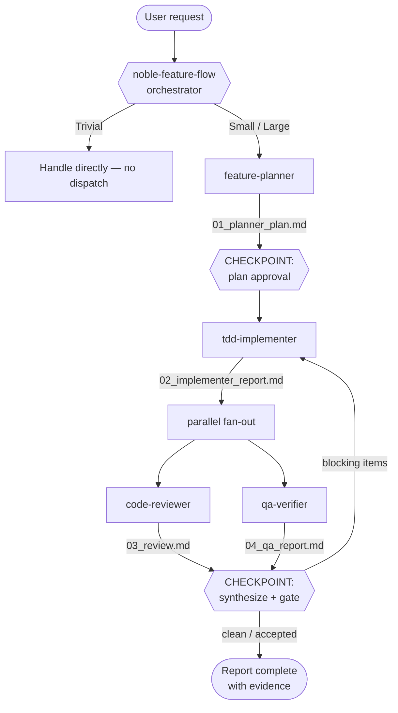

# Harness Architecture — Noble Voice Agent

Regenerated whenever an agent or skill changes. Must match `.claude/agents/` + `.claude/skills/`.

**Execution mode:** sub-agent pipeline with a parallel review/verify fan-out — deliberately *not* a self-coordinating team. Phases are sequential with mandatory human checkpoints (plan approval, diff review), and branch rules forbid autonomous remote actions, so a human gate is required. Review and verify are independent → they run in parallel.

**Triage is Phase 0** (3 tiers: Trivial / Small / Large) and runs **before** the context check, so a trivial request — or a trivial-sized follow-up on an existing `_workspace/` — never spawns an agent. Only the Large tier runs the full pipeline below; Small dispatches `tdd-implementer` + one `qa-verifier` pass.

## Orchestration flow

## Agents

| Agent | Type | Model | Tools | Role |
|---|---|---|---|---|
| `feature-planner` | subagent | opus | Read, Grep, Glob, Bash, WebFetch | Turn a request into a layer-aware, TDD-first plan. Read-only. |
| `tdd-implementer` | subagent | opus | Read, Write, Edit, Bash, Grep, Glob | Execute the approved plan test-first (RED→GREEN→REFACTOR). |
| `code-reviewer` | subagent | opus | Read, Grep, Glob, Bash | Review the diff for correctness/latency/async/convention. Read-only. |
| `qa-verifier` | subagent (`general-purpose`) | opus | Read, Grep, Glob, Bash | Run lint/test/coverage + cross-boundary seam checks; report evidence. |

## Skills

| Skill | Loaded by | Purpose |
|---|---|---|
| `noble-feature-flow` | orchestrator (main) | The lifecycle orchestrator (this flow). |
| `noble-voice-architecture` | planner, implementer, reviewer | Change-recipe map: where each change lives + the seam to wire. |
| `rag-quality` | planner, implementer, reviewer (when RAG-tagged) | Catalog/retrieval discipline + estate eval. |
| `latency-discipline` | planner, implementer, reviewer (when latency-tagged) | Hot-path rules + benchmark gates. |
| `testing-conventions` | planner, implementer, qa-verifier | pytest/asyncio conventions, markers, coverage. |

Standalone skills outside this harness (not part of the flow above): `learn-codebase` (teach/quiz/explain-diff — user-invoked, no agents), `inspect-code` (code-flow HTML visualizer — manual-only via `/inspect-code`, `disable-model-invocation`).

## Data passing

- **File-based** (durable, audit trail): `_workspace/{phase}_{agent}_{artifact}.md`, preserved after the run.
- **Return-value-based**: the orchestrator collects each agent's summary to present at checkpoints.
- Final code lands on the user's feature branch; no commit/push/PR without explicit instruction.
